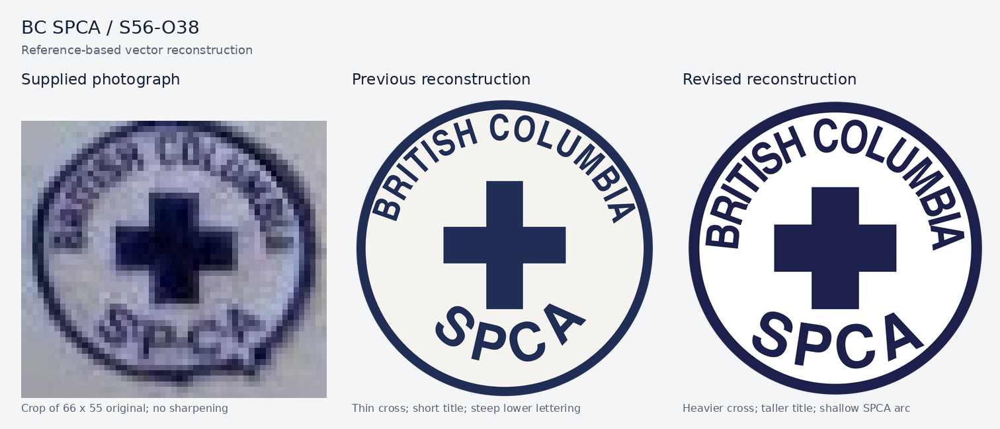
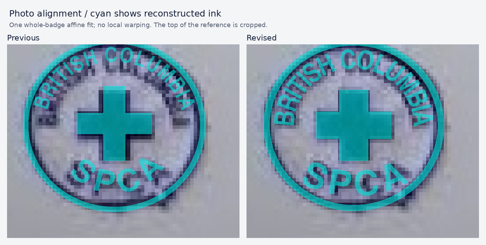

# British Columbia / SPCA roundel — S56-O38

Geometric reconstruction fitted to the **66 × 55 pixel photograph supplied on 22 October 2026**.
The supplied image is retained unchanged as `source/reference.jpeg`. Its small size supports the
composition and approximate proportions, but cannot establish the original typeface, calibrated
navy thread colour, exact stitch detail or physical dimensions. The user confirmed that the cloth
field is **pure white**: the blue-grey cast in the photograph is lighting, not a design colour.



## What changed

All dimensions below are drawing units on a 100 × 100 canvas, not millimetres.

| Component | Construction | Reason |
|---|---|---|
| Rim and field | Concentric circles, outer radius 48 and inner radius 44.5 | Keeps a clean circular patch and a constant 3.5-unit rim; omits the photograph's cloth bulge at lower right |
| Cross | One closed equal-arm polygon, 40 × 40 overall, 15.5-unit bars, centred at (50, 50) | The previous 12-unit bars were too thin; the square cross also puts its top closer to the reference |
| BRITISH COLUMBIA | 10.7-unit capitals on a radius-31.7 upper baseline; first/last letter centres at −84°/+84° | Taller lettering, extending farther down both sides than the earlier approximately ±71° layout |
| SPCA | 14-unit capitals on a radius-57 lower baseline, with its bottom at y = 89.5; outer letters rotated ±24° | A wider, shallower word, replacing the earlier roughly +41°/−47° end rotations |
| Colours | Navy `#1c204a`; pure white `#ffffff` | White cloth as confirmed by the user; the photograph's lighting cast is omitted. Navy remains an approximate flat thread colour. |

The letters reuse the atlas reconstruction's **substitute glyph outlines**, individually resized,
spaced by their advances and rotated along the new arcs. This is not a recovered historical font.
`source/atlas-S56-O38.svg` records the unchanged prior drawing and makes the lettering source and
before/after comparison reproducible. The original atlas SHA-256 is
`fc1abe7d50b32a2bad6ab7ba15c97f76306e1963314321a501cfdcb153d3610b`.

The new drawing uses **22 filled paths**: two circles, one cross and 19 letters. It has no live text,
font dependencies, embedded photograph, tracing contours, filters or embroidery texture.

## Rebuild

From the Patcher repository root:

```sh
node library/supplied/bc-spca-roundel/compose.mjs
python3 library/supplied/bc-spca-roundel/render_review.py
npm run library:import
npm run library:verify -- --source
```

`compose.mjs` needs only Node. `geometry.json` is the editable drawing recipe; changing it and
running the composer rebuilds `composed/S56-O38.svg` without a font or network request.

The review renderer needs **Inkscape and Pillow**. It produces the transparent `S56-O38.png`, the
480-pixel `preview.webp`, the comparison sheet and the overlay sheet. The library importer copies the
declared SVG and thumbnail to the existing `bc-spca/S56-O38` asset paths, updates the manifest and
preserves the atlas hash as replacement provenance. Its `replace` rule in `library/orgs.json` keeps the
improvement through future imports, while preserving the existing patch ID and deep link.

## Visual check and limitations



The overlays use the same **single whole-badge affine fit** for both drawings: source-pixel centre
(30.5, 23.0) and radii (25.7, 24.4). This accounts for the photograph's slight flattening and cropped
top; letters and cross are not locally warped to force agreement. Cyan denotes reconstructed ink.
The photograph is enlarged with nearest-neighbour sampling, without sharpening or synthesized detail.

The heavier cross, taller title and flatter lower lettering improve the visible composition. Remaining
small differences are comparable to individual source pixels and do not justify encoding arbitrary
cloth distortion into the geometry. These files are a documented reconstruction, not authenticated
issue artwork or a claim of an exact pixel match.
